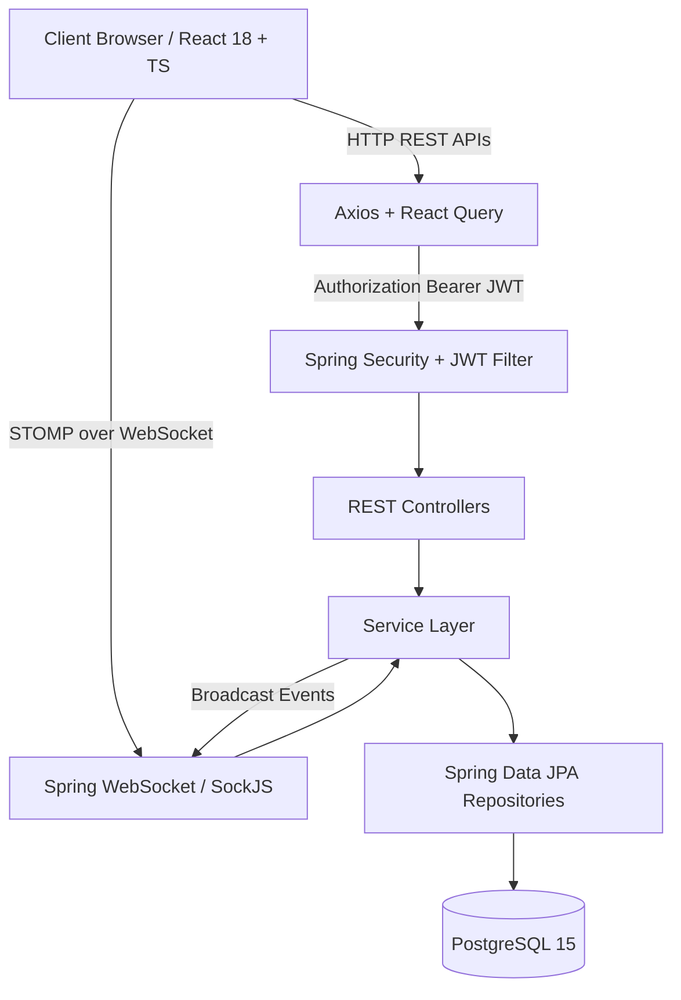
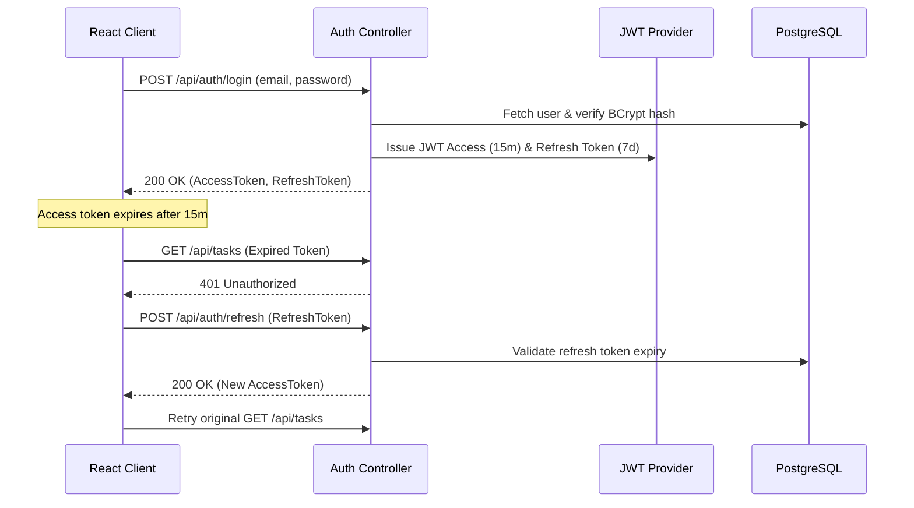

# TaskPulse — Enterprise Full-Stack Task Management System


TaskPulse is a professional, production-grade enterprise task management web application built with **Spring Boot 3**, **React 18**, **TypeScript**, **Tailwind CSS**, and **PostgreSQL**.

---

## 🌟 Key Features

- 🔐 **JWT Authentication & Refresh Token Rotation**: Secure BCrypt password hashing, stateless sessions, automated Axios token interceptors.
- 📋 **Interactive Drag-and-Drop Kanban Board**: Accessible dnd-kit columns (`TODO`, `IN_PROGRESS`, `COMPLETED`) with instant optimistic updates and rollback.
- ⚡ **Real-Time WebSockets**: Spring WebSocket & STOMP integration for instant cross-user task updates, comment pushes, and online presence tracking.
- 📊 **Productivity Analytics Dashboard**: Live metrics for total, pending, completed, and overdue tasks with completion percentages.
- 🔍 **Search, Filter & Sorting**: Debounced task title/description search, multi-field filters (Status, Priority, Assignee), and multi-criteria sorting.
- 💬 **Collaborative Comments**: Real-time task discussion threads with owner editing and deletion authorization.
- 🔔 **In-App Notifications**: Unread badge count, automated task assignment alerts, and deadline reminders.
- 🌙 **Dark & Light Mode**: Seamless dark mode support with automatic system preference detection.
- 📱 **Fully Responsive SaaS UI**: Collapsible mobile sidebar, horizontal drag-scroll Kanban, and keyboard accessibility shortcuts (`N`, `/`, `Esc`).

---

## 🏗️ Architecture

### System Architecture Diagram



### Authentication & Token Refresh Flow



---

## 🔑 Demo Credentials

| Role | Email | Password | Access Rights |
| :--- | :--- | :--- | :--- |
| **Admin** | `alice@demo.com` | `Password123!` | Full workspace access & admin rights |
| **User** | `bob@demo.com` | `Password123!` | Task creation, editing & assignments |
| **User** | `carol@demo.com` | `Password123!` | Task creation, editing & assignments |

---

## 🛠️ Technology Stack

### Backend
- **Framework**: Java 17, Spring Boot 3.2.3
- **Security**: Spring Security, JJWT (io.jsonwebtoken 0.12.5), BCrypt
- **Database & Persistence**: PostgreSQL 15, Spring Data JPA, Flyway Migrations
- **Real-Time**: Spring WebSocket, STOMP Protocol, SockJS
- **API Specification**: OpenAPI 3.0 / Swagger UI (springdoc)
- **Testing**: JUnit 5, Mockito, Testcontainers

### Frontend
- **Core**: React 18, TypeScript, Vite
- **Styling**: Tailwind CSS, Lucide Icons, Inter Font
- **State & Server Query**: TanStack React Query v5, Context API
- **HTTP & WS Client**: Axios, `@stomp/stompjs`, SockJS-client
- **Drag and Drop**: `@dnd-kit/core`, `@dnd-kit/sortable`
- **Testing**: Vitest, React Testing Library

---

## 📁 Project Structure

```text
week8-task-manager-fullstack/
├── backend/
│   ├── src/main/java/com/taskmanager/
│   │   ├── config/ (SecurityConfig, WebSocketConfig, CorsConfig, JpaConfig)
│   │   ├── controller/ (AuthController, TaskController, CommentController, NotificationController, UserController)
│   │   ├── service/ (AuthService, TaskService, CommentService, NotificationService, WebSocketService)
│   │   ├── security/ (JwtTokenProvider, JwtAuthenticationFilter, CustomUserDetailsService)
│   │   ├── model/ (entity, dto, enums)
│   │   ├── repository/ (UserRepository, TaskRepository, CommentRepository, etc.)
│   │   ├── mapper/ (EntityMapper)
│   │   └── exception/ (GlobalExceptionHandler, ResourceNotFoundException)
│   ├── src/main/resources/
│   │   ├── application.yml
│   │   └── db/migration/ (V1__initial_schema.sql, V2__seed_data.sql)
│   ├── Dockerfile
│   └── pom.xml
│
├── frontend/
│   ├── src/
│   │   ├── components/ (kanban, tasks, comments, notifications, dashboard, layout, common)
│   │   ├── pages/ (DashboardPage, AllTasksPage, MyTasksPage, TaskDetailsPage, TeamPage, CalendarPage, SettingsPage)
│   │   ├── services/ (api, authService, taskService, commentService, notificationService)
│   │   ├── context/ (AuthContext, ThemeContext, WebSocketContext)
│   │   ├── types/ (index.ts)
│   │   ├── App.tsx
│   │   └── main.tsx
│   ├── Dockerfile
│   ├── nginx.conf
│   ├── package.json
│   ├── vite.config.ts
│   └── tailwind.config.js
│
├── docker-compose.yml
├── .env.example
├── README.md
└── .github/workflows/ci.yml
```

---

## 🚀 Quick Start & Local Setup

### Option 1: Running with Docker Compose (Recommended)

Make sure Docker Desktop is installed and running on your machine:

```bash
# Clone or navigate to the repository folder
cd week8-task-manager-fullstack

# Build and start PostgreSQL, Spring Boot backend, and React frontend
docker compose up --build
```

Access the application in your browser:
- **Frontend App**: [http://localhost:3000](http://localhost:3000)
- **Backend REST API**: [http://localhost:8080/api](http://localhost:8080/api)
- **Swagger Documentation**: [http://localhost:8080/swagger-ui.html](http://localhost:8080/swagger-ui.html)

---

### Option 2: Running Locally Without Docker

#### Prerequisites
- Java 17+ JDK installed
- Maven installed
- Node.js 18+ & npm installed
- Local PostgreSQL instance running on port 5432 with database `taskmanager` (User: `taskuser`, Password: `taskpass`)

#### Step 1: Start Backend
```bash
cd backend
mvn spring-boot:run
```

#### Step 2: Start Frontend
```bash
cd frontend
npm install
npm run dev
```
Open [http://localhost:5173](http://localhost:5173) in your browser.

---

## 🧪 Running Tests

### Backend Unit Tests
```bash
cd backend
mvn clean test
```

### Frontend Vitest Tests
```bash
cd frontend
npm run test
```

---

## 📄 License
This project is open-source and released under the MIT License.
